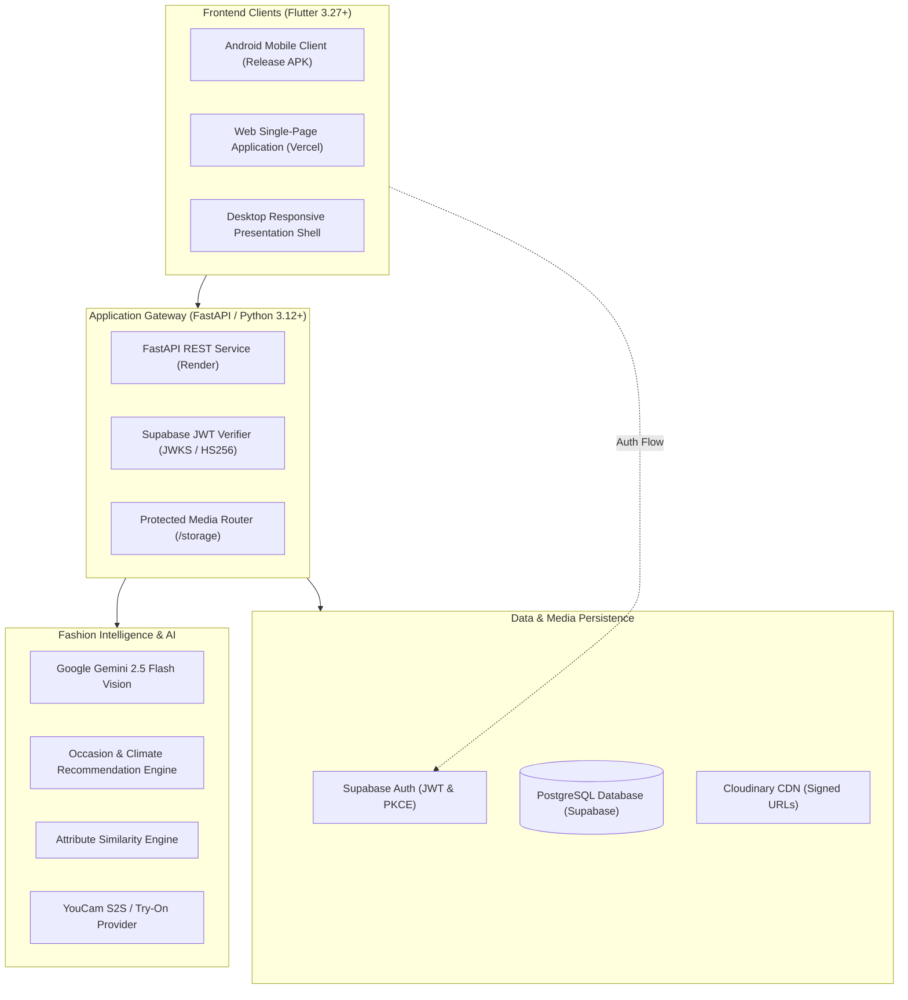

<p align="center">
  
</p>

<p align="center">
  <strong>Intelligent Personal Wardrobe Digitizer, AI Stylist & Campus Fashion Network</strong>
</p>

<p align="center">
  <a href="#features"></a>
  <a href="docs/development.md"></a>
  <a href="docs/development.md"></a>
  <a href="docs/development.md"></a>
  <a href="docs/database.md"></a>
  <a href="docs/architecture.md"></a>
  <a href="docs/deployment.md"></a>
</p>

---

## Overview

**adaa** is an AI-powered wardrobe intelligence studio and fashion-sharing platform. It transforms personal clothing collections into structured digital assets, generates curated occasion lookbooks tailored to local weather, decodes outfit inspirations into closet matches, and connects campus communities through secure garment-borrowing circles.

Built with an editorial aesthetic featuring warm ivory, deep forest, and champagne gold palettes, adaa delivers a unified experience across native Android devices and modern web browsers.

---

## Core Capabilities

```
                  ┌──────────────────────────────────────────────┐
                  │                 adaa Studio                  │
                  └──────┬────────────────┬──────────────┬───────┘
                         │                │              │
           ┌─────────────▼────┐    ┌──────▼──────┐   ┌───▼─────────────┐
           │ Digital Wardrobe │    │  AI Stylist │   │  Style Circles  │
           │  & Multimodal AI │    │  & Lookbook │   │  & Shared Closet│
           └──────────────────┘    └─────────────┘   └─────────────────┘
```

### 1. Smart Digital Closet & Multimodal Digitization
- **Automated Garment Recognition**: Analyzes photos with Google Gemini 2.5 Flash to extract category, subcategory, primary/secondary colors, fabric material, silhouette fit, pattern, and formality.
- **Editorial Wardrobe Catalog**: High-fashion 4/5 aspect ratio cards with category filtering (Tops, Bottoms, Outerwear, Dresses, Footwear, Bags, Accessories), brand tagging, and condition tracking.
- **Human-in-the-Loop Review**: Multi-item review screens allow users to verify or edit AI-extracted attributes before committing items to their wardrobe.

### 2. AI Stylist & Curated Lookbooks
- **Weather & Occasion Intelligence**: Algorithmic and generative styling curating outfits based on upcoming calendar events, ambient temperature, and personal fit preferences.
- **Inspiration Outfit Matching**: Deconstructs editorial and street-style inspiration photos into individual components, querying the closet using a multi-attribute weighted similarity scoring matrix.
- **Saved Looks Gallery**: Curate, name, tag, and revisit styled combinations for effortless morning preparation.

### 3. Campus Fashion Circles & Shared Closets
- **Curated Style Communities**: Create or join campus fashion circles with creator-managed membership approval workflows.
- **Shared Closets**: List select personal wardrobe pieces into trusted community closets with private/public visibility toggles.
- **Garment Borrowing Lifecycle**: Structured request flow (*pending &rarr; accepted / declined &rarr; completed*) with in-app activity notifications and database-level duplicate request prevention.

### 4. Sizing Preferences & Granular Privacy
- **Sizing Profile**: Store measurements and sizing standards across tops, bottoms, shoe size, and preferred fit styles.
- **Field-Level Privacy Controls**: Granular toggles allow users to selectively share or conceal bio, age, phone number, email address, and fit preferences on community-facing profiles.

### 5. Responsive Presentation Shell (Web & Desktop)
- **Interactive Dual-Panel Layout**: On desktop screens, visitors experience an editorial presentation shell with an auto-advancing feature carousel, instant demo access, and a live, interactive smartphone frame hosting the complete Flutter application.
- **Native Fullscreen Mobile**: Automatically detects viewports under 960px to provide a seamless, edge-to-edge mobile web experience.

> [!NOTE]
> **Implementation Status & Provider Modes**:
> - **Virtual Try-On**: Full asynchronous job submission, polling, and display pipeline is operational. Uses high-fidelity simulation by default (`TRYON_PROVIDER=mock`); live production integration connects to Perfect Corp's YouCam S2S API when commercial credentials are supplied.
> - **Institutional Student Verification**: Email domain validation is database-trigger protected (`is_student_verified`); enterprise campus SSO verification is scheduled for future release.

---

## System Architecture



For complete architectural specifications, component diagrams, and sequence flows, see [Architecture & System Design](docs/architecture.md).

---

## Documentation Hub

Comprehensive technical documentation is maintained in the `docs/` directory:

| Document | Focus Area | Contents |
| :--- | :--- | :--- |
| [Architecture & System Design](docs/architecture.md) | **System Architecture** | Mermaid diagrams, frontend state architecture, service layer patterns, and security model |
| [Developer Guide & Local Setup](docs/development.md) | **Getting Started** | Prerequisites, virtual environment setup, local API server, Flutter run commands, and troubleshooting |
| [REST API Reference](docs/api.md) | **API Reference** | Complete endpoint contracts, request/response schemas, authentication headers, and error codes |
| [Database Architecture](docs/database.md) | **Persistence & Schema** | PostgreSQL schema, SQLite engine, ERD diagram, Row-Level Security (RLS), and migrations |
| [Deployment & Operations](docs/deployment.md) | **Production Deployment** | Render web service, Vercel web hosting, Android release APK builds, and operational checklists |

---

## Technology Stack

| Layer | Technology | Purpose |
| :--- | :--- | :--- |
| **Frontend Framework** | Flutter 3.27+ / Dart 3.6+ | Cross-platform client for Android and Web |
| **State Management** | Provider (`ChangeNotifier`) | Reactive, session-isolated state management |
| **Backend Framework** | FastAPI 0.115+ / Python 3.12+ | High-performance asynchronous REST API |
| **Data Validation** | Pydantic v2 | Strict request/response schema enforcement |
| **ORM & Database** | SQLAlchemy 2.0 / PostgreSQL | Relational modeling with connection pooling & recycling |
| **Authentication** | Supabase Auth (PKCE / JWT) | Cryptographic identity verification via asymmetric JWKS |
| **Multimodal Vision** | Google Gemini 2.5 Flash | Garment attribute deconstruction and classification |
| **Virtual Try-On** | Perfect Corp YouCam S2S API | Photorealistic digital garment simulation |
| **Media Delivery** | Cloudinary / Local Protected | Authenticated uploads and time-limited signed delivery URLs |
| **Production Hosting** | Render (API) & Vercel (Web) | Cloud application hosting with automatic health checks |

---

## Quick Start

### 1. Prerequisites
- **Python 3.12+**
- **Flutter SDK 3.27+** (`flutter doctor` should verify Chrome and Android toolchains)
- **Git**

### 2. Backend Service Setup

```bash
# Navigate to backend
cd backend

# Create and activate virtual environment
python -m venv .venv
.\.venv\Scripts\Activate.ps1    # Windows PowerShell
# source .venv/bin/activate     # macOS / Linux

# Install dependencies
pip install -r requirements.txt

# Configure environment
cp .env.example .env

# Start development server
uvicorn app.main:app --reload --port 8000
```

Verify backend at [http://127.0.0.1:8000/docs](http://127.0.0.1:8000/docs).

### 3. Flutter Client Setup

```bash
# Navigate to mobile
cd mobile

# Resolve Flutter dependencies
flutter pub get

# Run on Chrome (Web) connected to local backend
flutter run -d chrome --dart-define=API_BASE_URL=http://127.0.0.1:8000

# Run on connected Android device / emulator
flutter run -d android --dart-define=API_BASE_URL=http://10.0.2.2:8000
```

*For detailed instructions, environment variables, and troubleshooting, refer to the [Developer Guide](docs/development.md).*

---

## Security & Privacy Philosophy

adaa is designed with privacy and data protection at its foundation:

1. **Zero Open Media Buckets**: Garment photos and silhouettes are never exposed through unauthenticated static buckets. All media URLs are signed with strict time-to-live restrictions.
2. **Session Isolation**: Multi-account device safety is enforced; logging out purges in-memory provider caches, preventing cross-session data leaks.
3. **Database-Level Defense**: Database triggers prohibit tampering with account identifiers, primary emails, and verified student credentials via client APIs.
4. **Row-Level Security**: Sensitive user collections (e.g., saved outfits, notifications) enforce PostgreSQL RLS policies to guarantee multi-tenant boundary integrity.

---

## Repository Structure

```
app/
├── backend/                  # FastAPI microservice
│   ├── app/                  # Application code (api, auth, services, models, schemas)
│   ├── tests/                # Automated pytest suite (105 tests)
│   ├── requirements.txt      # Python dependencies
│   └── .env.example          # Backend environment template
├── mobile/                   # Flutter cross-platform application
│   ├── assets/               # Approved branding logos, icons, and typefaces
│   ├── lib/                  # Dart application source (core, features, state)
│   ├── test/                 # Flutter unit and widget tests
│   └── web/                  # Web entry point and manifest
├── supabase/
│   └── migrations/           # PostgreSQL migrations (0001 to 0005)
├── docs/                     # Comprehensive architecture and operation guides
├── .env.example              # Monorepo configuration template
├── render.yaml               # Render Cloud infrastructure specification
├── vercel.json               # Vercel deployment specification
└── README.md                 # Project landing page
```

---

## Contribution & Licensing

- **License**: All rights reserved. Please review repository permissions before reuse or distribution.
- **Contributions**: Contributions, bug reports, and architectural feedback are welcomed. Please review the [Developer Guide](docs/development.md) and ensure that all automated test suites pass prior to opening a pull request.
