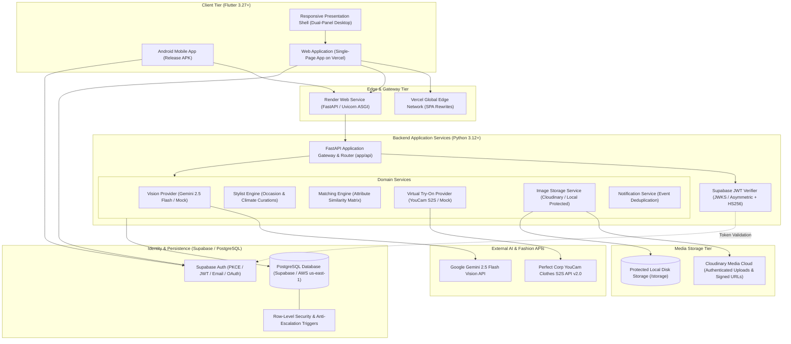
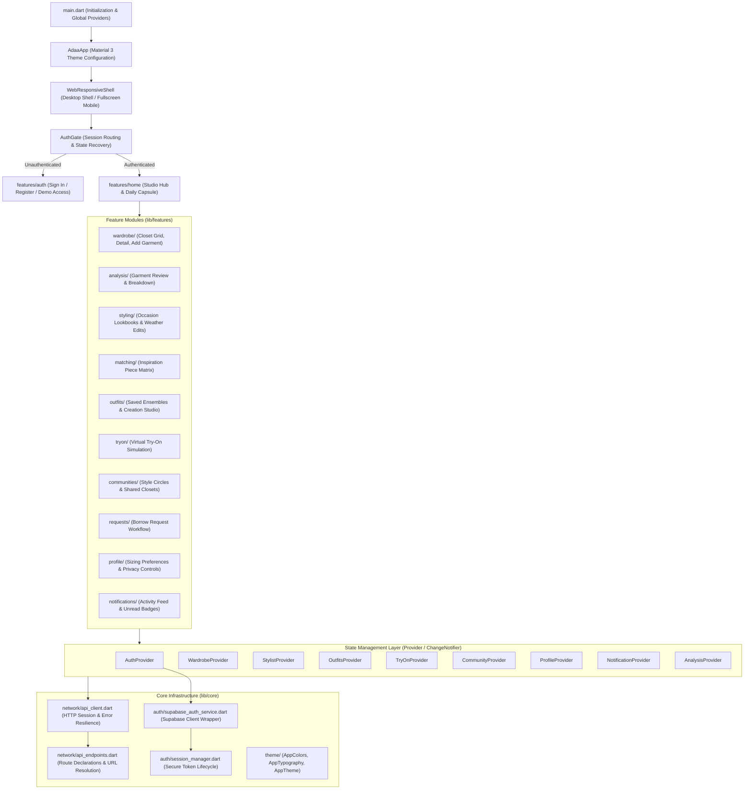
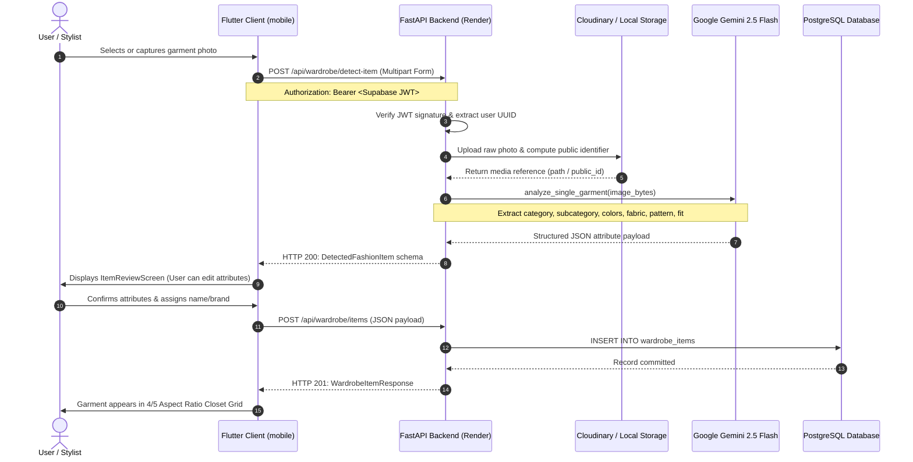
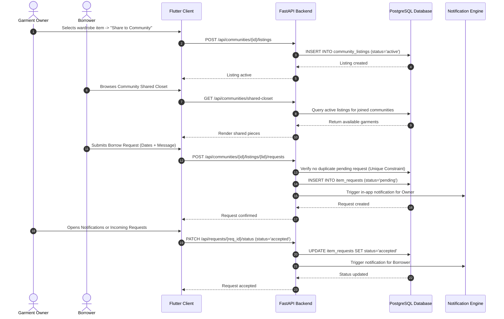
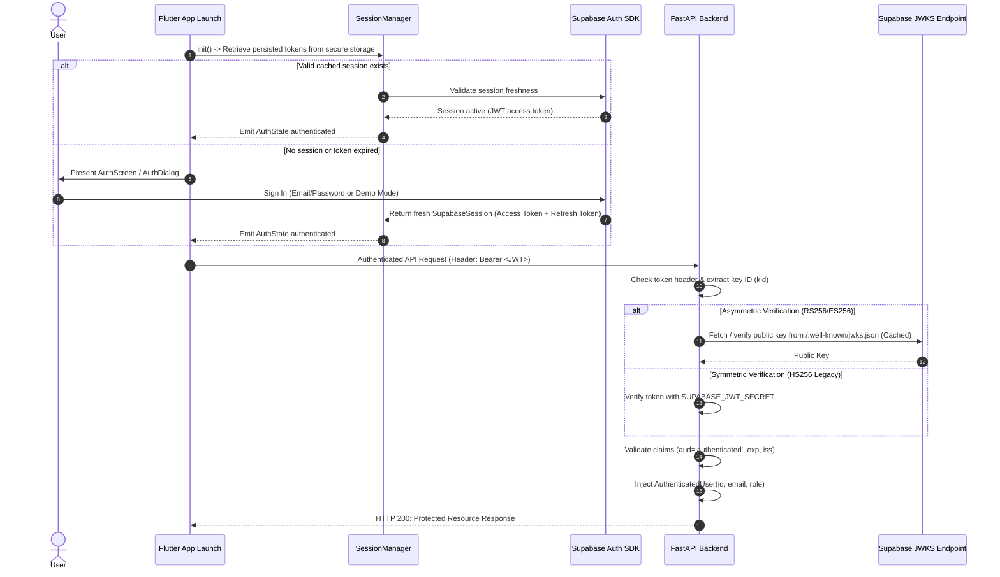

# adaa | Architecture & System Design

This document details the software architecture, component relationships, data pipelines, and security mechanisms governing **adaa** across both client and server environments.

---

## 1. System Overview

adaa is designed as a modular, decoupled fashion intelligence platform. It pairs a cross-platform client with an asynchronous FastAPI microservice, backed by Supabase for identity and transactional persistence, Cloudinary for authenticated media delivery, and Google Gemini 2.5 Flash for multimodal vision comprehension.

---

## 2. Frontend Architecture (Flutter)

The client application is built with **Flutter 3.27+** and **Dart 3.6+**. It uses a layered architecture separating visual presentation, reactive state management via `ChangeNotifier` providers, network protocol clients, and local session management.

### Component Structure

### State Management & Lifecycle

- **Session Isolation**: Each provider responds to authentication lifecycle events emitted by `AuthProvider`. When a user signs out, providers reset their in-memory models to eliminate state contamination across distinct accounts.
- **Network Resilience**: `ApiClient` automatically extracts the active Supabase JWT from `SessionManager` and attaches it as an `Authorization: Bearer <TOKEN>` header.
- **Dynamic Endpoint Probing**: In local environments, `ApiEndpoints` automatically resolves target backend addresses depending on whether the application runs on Web (`127.0.0.1:8000`), an Android Emulator (`10.0.2.2:8000`), or a physical mobile device with `adb reverse` bridge.

---

## 3. Backend Architecture (FastAPI)

The backend service is built with **FastAPI** and **Pydantic v2**, following a clean layered service pattern.

```mermaid
graph LR
    subgraph Ingress["Ingress Layer"]
        CORS["FastAPI CORSMiddleware"]
        StaticProt["Protected Storage Routes (/storage)"]
        HealthRoute["Health Probes (/health)"]
    end

    subgraph Routers["API Routers (app/api)"]
        R_Auth["routes_auth.py"]
        R_Wardrobe["routes_wardrobe.py"]
        R_Analysis["routes_analysis.py"]
        R_Matching["routes_matching.py"]
        R_Outfits["routes_outfits.py"]
        R_Stylist["routes_recommendations.py"]
        R_TryOn["routes_tryon.py"]
        R_Comm["routes_communities.py"]
        R_Requests["routes_requests.py"]
        R_Users["routes_users.py"]
        R_Notify["routes_notifications.py"]
    end

    subgraph Security["Security & Authentication"]
        JWKSDecoder["SupabaseJWTVerifier (JWKS Asymmetric / HS256)"]
        UserDep["get_current_user / get_optional_current_user"]
        PrivacyFilter["Field-Level Profile Privacy Sanitizer"]
    end

    subgraph DomainServices["Service Layer (app/services)"]
        VisionProv["VisionProvider (GeminiVisionProvider)"]
        StylistEngine["StylistService (Rule-Based & Generative)"]
        MatchEngine["MatchingEngine (Jaccard / Color Proximity)"]
        TryOnProv["TryOnProvider (YouCam S2S / Mock)"]
        ImgStorage["ImageStorageService (Cloudinary Signed Delivery)"]
        NotifSvc["NotificationService (Event Deduplication)"]
    end

    subgraph Persistence["Persistence Layer"]
        Engine["SQLAlchemy Engine (Connection Pooling & Pre-Ping)"]
        Models["SQLAlchemy Declarative Models (app/models.py)"]
        MigrationMgr["Database Migration Engine (init_db)"]
    end

    CORS --> Routers
    Routers --> Security
    Security --> DomainServices
    DomainServices --> Persistence
```

### Key Subsystems

1. **Dual Database Dialect Support**:
   - **PostgreSQL (Supabase)**: Configured for production deployment with connection pooling (`pool_size=10`, `max_overflow=15`), connection liveness testing (`pool_pre_ping=True`), and connection recycling (`pool_recycle=1800`) to avoid dropped sockets behind cloud NAT/firewalls.
   - **SQLite**: Seamlessly supported for zero-dependency local development and testing with thread safety flags (`check_same_thread=False`).
2. **Zero-Trust Media Access**:
   - User photos are **never** mounted via open static file servers.
   - Cloudinary assets are delivered through signed URLs with time-to-live restrictions (`IMAGE_DELIVERY_TTL_SECONDS=1800`).
   - Local storage fallbacks enforce ownership validation and path traversal checks within `routes_storage.py`.
3. **Graceful Provider Fallbacks**:
   - Multimodal vision defaults to Gemini 2.5 Flash when `GEMINI_API_KEY` is present, falling back to a structured mock provider if unconfigured.
   - Virtual Try-On invokes YouCam S2S when configured, or transparently falls back to an asynchronous simulation provider for offline development.

---

## 4. Key Request Flows

### A. Garment Digitization & Ingestion Flow

This sequence demonstrates how a physical garment photo is captured, processed by Gemini 2.5 Flash, reviewed by the user, and committed to the digital closet.

---

### B. Campus Style Circle & Garment Borrowing Flow

This sequence traces the lifecycle of sharing a wardrobe piece within a trusted style circle and requesting to borrow it.

---

### C. Authentication & Session Recovery Flow

This sequence illustrates how user sessions are established, restored across application restarts, and securely validated against the backend.

---

## 5. Security & Privacy Model

| Defense Layer | Implementation Strategy |
| :--- | :--- |
| **Authentication** | Supabase Auth issuing cryptographic JWTs. Verified on backend via asymmetric JWKS or HS256 secret. |
| **Session Isolation** | Multi-account safety: in-memory state in Flutter is cleared on logout; backend database queries strictly partition records by `user_id = current_user.id`. |
| **Column Anti-Escalation** | PostgreSQL trigger `protect_profile_fields()` blocks client modifications to `id`, `email`, `created_at`, and `is_student_verified`. |
| **Field-Level Privacy** | User profile visibility controls (`show_email`, `show_phone`, `show_age`, `show_fit_preferences`) ensure unshared fields are stripped before transmitting public profiles. |
| **Zero Public Media Buckets** | Cloudinary media delivered with signed authentication tokens; local files guarded against directory traversal attacks (`Path.resolve()`). |
| **Deduplication Constraints** | Unique SQL partial indexes prevent duplicate pending borrow requests and idempotent notification delivery. |
