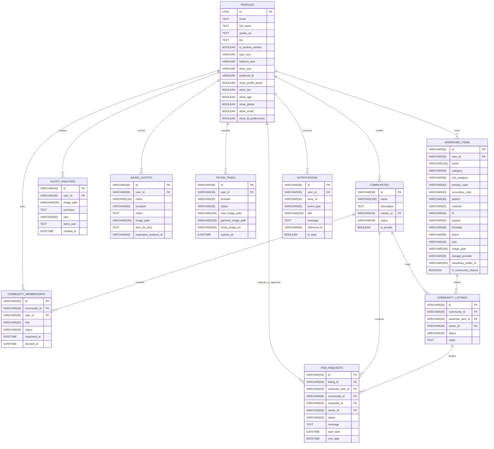

# adaa | Database Architecture & Schema Reference

This document outlines the data model, relationship architecture, security policies, and migration workflows powering the **adaa** platform.

---

## 1. Database Architecture & Dialects

adaa employs a hybrid database strategy designed for both cloud-native scale and zero-dependency local development:

- **Production (PostgreSQL / Supabase)**: Deployed on PostgreSQL with connection pooling (`pool_size=10`, `max_overflow=15`), periodic connection recycling (`pool_recycle=1800`), and connection pre-pings (`pool_pre_ping=True`) to gracefully handle cloud proxy timeouts.
- **Local Development & Pytest (SQLite)**: File-backed SQLite (`wardrobelens.db`) or in-memory SQLite instances with thread safety flags (`check_same_thread=False`).
- **Dynamic Additive Migrations**: Managed via `init_db()` in `backend/app/database.py`, using a `schema_migrations` tracking table to dynamically verify and add missing columns across dialect changes.

---

## 2. Entity-Relationship Diagram (ERD)



---

## 3. Migration Sequence (`supabase/migrations/`)

Database schema evolution is documented in chronological SQL migrations executed within PostgreSQL:

### `0001_initial_schema.sql`
- Creates `public.profiles` referencing `auth.users(id)` with automatic `CASCADE` on deletion.
- **Trigger `handle_new_user()`**: Automatically provisions a `profiles` record whenever a user authenticates via Supabase (email confirmation or Google OAuth).
- **Security Defenses (`protect_profile_fields()`)**: Restricts client modifications via PostgREST to prevent privilege escalation:
  - Prohibits clients from tampering with `id`, `email`, or `created_at`.
  - Disallows direct modification of `is_student_verified` (requires institutional verification workflow).

### `0002_item_requests.sql`
- Provisions `item_requests` table for garment borrowing workflows.
- Foreign keys link to `community_listings`, `wardrobe_items`, and `communities`.
- **Constraint `uq_item_requests_pending`**: Partial unique index enforcing that a user cannot submit multiple concurrent `pending` requests for the same listing.

### `0003_user_profiles_and_privacy.sql`
- Extends `public.profiles` with fashion sizing parameters:
  - `tops_size`, `bottoms_size`, `shoe_size`, `preferred_fit`, `preferred_styles`.
- Adds granular field-level privacy visibility toggles:
  - `show_profile_photo`, `show_bio`, `show_age`, `show_phone`, `show_email`, `show_fit_preferences`, `show_preferred_styles`.

### `0004_notifications.sql`
- Provisions `public.notifications` table for in-app activity tracking.
- Enables **Row-Level Security (RLS)** ensuring users only read and update their own notifications.
- **Constraint `uq_notifications_dedup`**: Enforces event deduplication on `(user_id, event_type, reference_id, reference_type)` to guarantee idempotent notifications.

### `0005_saved_outfits.sql`
- Provisions `public.saved_outfits` table.
- Enables full **Row-Level Security (RLS)** policies for SELECT, INSERT, UPDATE, and DELETE operations, isolating ensembles by `user_id = auth.uid()::text`.

---

## 4. Row-Level Security (RLS) Policies

All tables handling private user data in PostgreSQL enforce strict RLS policies:

```sql
-- Example: Row-Level Security on Saved Outfits
ALTER TABLE public.saved_outfits ENABLE ROW LEVEL SECURITY;

CREATE POLICY "saved_outfits_select_policy"
    ON public.saved_outfits FOR SELECT TO authenticated
    USING (user_id = auth.uid()::text);

CREATE POLICY "saved_outfits_insert_policy"
    ON public.saved_outfits FOR INSERT TO authenticated
    WITH CHECK (user_id = auth.uid()::text);
```

---

## 5. Migration & Replication Scripts

For operators transitioning data from an offline SQLite instance into production Supabase PostgreSQL:

- **`backend/app/scripts/migrate_sqlite_to_pg.py`**: Reads SQLite records, normalizes UUID and timestamp formats, handles foreign key dependencies, and streams records into PostgreSQL within a transaction.
- **`backend/app/scripts/verify_migration_result.py`**: Executes checksum queries and record count verifications across all tables to confirm 100% data fidelity post-migration.
