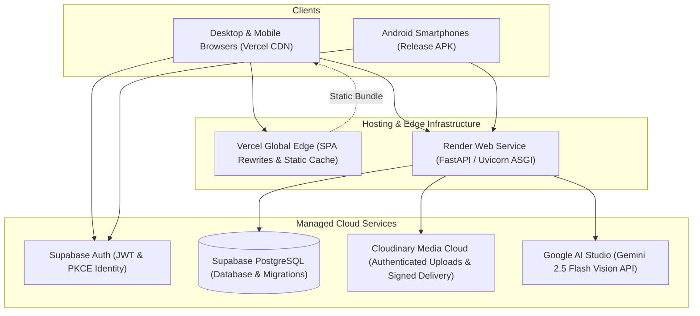

# adaa | Deployment & Infrastructure Guide

This guide provides deployment instructions and operational procedures for the **adaa** ecosystem across the Render backend service, Vercel web hosting, and Android release distribution.

---

## 1. Production Architecture Overview



---

## 2. Backend Service Deployment (Render)

The backend service is configured as a Render Web Service via `render.yaml`.

### Step 2.1: Infrastructure Specification (`render.yaml`)

```yaml
services:
  - type: web
    name: wardrobelens-backend
    runtime: python
    rootDir: backend
    buildCommand: pip install --upgrade pip && pip install -r requirements.txt
    startCommand: uvicorn app.main:app --host 0.0.0.0 --port $PORT
    healthCheckPath: /health
    plan: free
    autoDeploy: false
```

### Step 2.2: Environment Variables Configuration

Configure the following environment variables within the Render Dashboard (under **Environment**):

| Key | Sync Setting | Recommended Production Value |
| :--- | :--- | :--- |
| `ENVIRONMENT` | Direct | `production` |
| `DEBUG` | Direct | `false` |
| `HOST` | Direct | `0.0.0.0` |
| `DATABASE_URL` | Secret (`sync: false`) | `postgresql+psycopg2://postgres:[PASSWORD]@[HOST]:5432/postgres` |
| `SUPABASE_URL` | Secret (`sync: false`) | `https://[PROJECT_ID].supabase.co` |
| `SUPABASE_AUDIENCE` | Direct | `authenticated` |
| `STORAGE_BACKEND` | Direct | `cloudinary` |
| `CLOUDINARY_CLOUD_NAME` | Secret (`sync: false`) | `your_cloudinary_cloud_name` |
| `CLOUDINARY_API_KEY` | Secret (`sync: false`) | `your_cloudinary_api_key` |
| `CLOUDINARY_API_SECRET` | Secret (`sync: false`) | `your_cloudinary_api_secret` |
| `CLOUDINARY_SECURE_DELIVERY` | Direct | `true` |
| `IMAGE_DELIVERY_TTL_SECONDS` | Direct | `1800` |
| `VISION_PROVIDER` | Direct | `gemini` |
| `GEMINI_API_KEY` | Secret (`sync: false`) | `your_google_ai_studio_key` |
| `GEMINI_MODEL` | Direct | `gemini-2.5-flash` |
| `TRYON_PROVIDER` | Direct | `mock` (or `youcam` when commercial credentials provided) |
| `TRYON_RETENTION_DAYS` | Direct | `7` |

### Step 2.3: Verification

Once deployed, verify the deployment:

```bash
curl -f https://adaa-umsc.onrender.com/health
```

Expected output:
```json
{
  "status": "healthy",
  "service": "WardrobeLens Backend",
  "database": "connected",
  "environment": "production"
}
```

---

## 3. Flutter Web Deployment (Vercel)

The web client is hosted on Vercel as a Single-Page Application (SPA).

### Step 3.1: Build the Web Artifact

From the `mobile/` directory, compile the release bundle targeting the production API:

```powershell
cd mobile

flutter build web --release \
  --dart-define=API_BASE_URL=https://adaa-umsc.onrender.com \
  --dart-define=DEMO_EMAIL=demo@adaa.style \
  --dart-define=DEMO_PASSWORD=your_demo_password
```

The compiled assets are generated in `mobile/build/web/`.

### Step 3.2: SPA Routing Specification (`vercel.json`)

Vercel routing configuration redirects all requests to `index.html` to support client-side routing:

```json
{
  "outputDirectory": "mobile/build/web",
  "rewrites": [
    {
      "source": "/(.*)",
      "destination": "/index.html"
    }
  ]
}
```

### Step 3.3: Deploy via Vercel CLI

```powershell
# From mobile/ directory:
vercel deploy              # Preview deployment
vercel deploy --prod       # Production deployment
```

> [!WARNING]
> Build-time variables injected via `--dart-define` into Flutter Web become inspectable in client-side JavaScript bundles. The demo account must only contain curated, non-sensitive showcase data. Never supply personal or administrative credentials.

---

## 4. Android Release Distribution

### Step 4.1: Build Release APK

From the `mobile/` directory:

```powershell
cd mobile
flutter build apk --release --dart-define=API_BASE_URL=https://adaa-umsc.onrender.com
```

- **Output APK Artifact**: `mobile/build/app/outputs/flutter-apk/app-release.apk`

### Step 4.2: Install on Connected Android Device

```powershell
adb install -r mobile/build/app/outputs/flutter-apk/app-release.apk
```

### Step 4.3: App Store Release Key Signing

For Google Play Store distribution, configure production keystore signing in `mobile/android/key.properties`:

```properties
storePassword=your_keystore_password
keyPassword=your_key_password
keyAlias=your_key_alias
storeFile=/path/to/upload-keystore.jks
```

Build the release Android App Bundle (AAB):
```powershell
flutter build appbundle --release --dart-define=API_BASE_URL=https://adaa-umsc.onrender.com
```

---

## 5. Security & Operational Checklist

- [x] **No hardcoded secrets**: All API keys, database credentials, and signing secrets are managed via cloud environment managers.
- [x] **Zero-trust media delivery**: Cloudinary assets are delivered with short-lived signed tokens (`TTL = 1800s`).
- [x] **Public Anon Key only on client**: Flutter clients only receive the Supabase public anonymous key, with database integrity protected by Row-Level Security.
- [x] **Connection pool recycling**: Render free-tier or cloud firewalls terminate idle sockets; SQLAlchemy `pool_recycle=1800` and `pool_pre_ping=True` prevent broken pipe exceptions.
