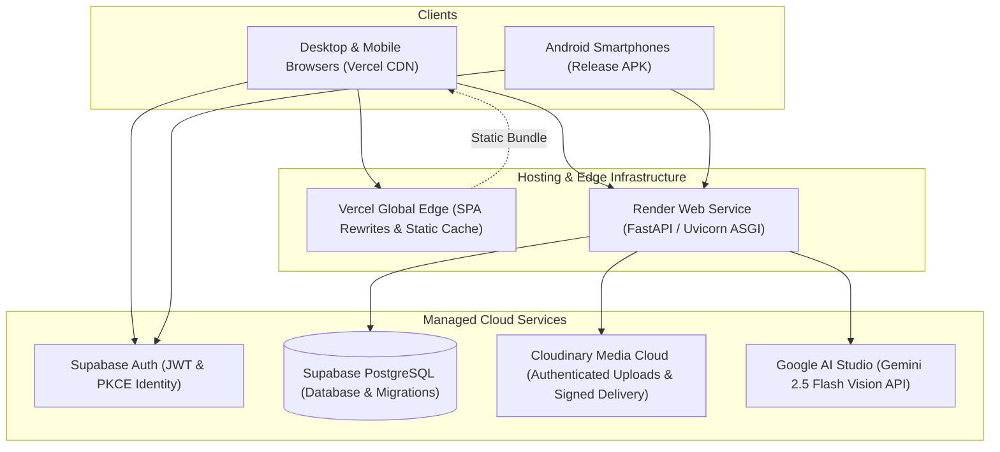

# adaa | Deployment & Infrastructure Guide

This guide provides deployment instructions and operational procedures for the **adaa** ecosystem across the Render backend service, Vercel web hosting, and Android release distribution.

---

## 1. Production Architecture Overview



---

## 2. Backend Service Deployment (Render)

The backend service is configured as a Render Web Service via `render.yaml`.

### Step 2.1: Infrastructure Specification (`render.yaml`)

```yaml
services:
  - type: web
    name: wardrobelens-backend
    runtime: python
    rootDir: backend
    buildCommand: pip install --upgrade pip && pip install -r requirements.txt
    startCommand: uvicorn app.main:app --host 0.0.0.0 --port $PORT
    healthCheckPath: /health
    plan: free
    autoDeploy: false
```

### Step 2.2: Environment Variables Configuration

Configure the following environment variables within the Render Dashboard (under **Environment**):

| Key | Sync Setting | Recommended Production Value |
| :--- | :--- | :--- |
| `ENVIRONMENT` | Direct | `production` |
| `DEBUG` | Direct | `false` |
| `HOST` | Direct | `0.0.0.0` |
| `DATABASE_URL` | Secret (`sync: false`) | `postgresql+psycopg2://postgres:[PASSWORD]@[HOST]:5432/postgres` |
| `SUPABASE_URL` | Secret (`sync: false`) | `https://[PROJECT_ID].supabase.co` |
| `SUPABASE_AUDIENCE` | Direct | `authenticated` |
| `STORAGE_BACKEND` | Direct | `cloudinary` |
| `CLOUDINARY_CLOUD_NAME` | Secret (`sync: false`) | `your_cloudinary_cloud_name` |
| `CLOUDINARY_API_KEY` | Secret (`sync: false`) | `your_cloudinary_api_key` |
| `CLOUDINARY_API_SECRET` | Secret (`sync: false`) | `your_cloudinary_api_secret` |
| `CLOUDINARY_SECURE_DELIVERY` | Direct | `true` |
| `IMAGE_DELIVERY_TTL_SECONDS` | Direct | `1800` |
| `CLOUDINARY_AUTH_TOKEN_KEY` | Secret (`sync: false`) | *(Optional - Paid Plans Only)*: URL signing token key from Cloudinary Console (**Settings -> Security -> URL Signing**) for paid Advanced/Enterprise plans. On the Free plan, leave empty. |
| `OPERATOR_SECRET` | Secret (`sync: false`) | Secret token for operator maintenance CLI scripts and scheduled cron endpoints. |
| `VISION_PROVIDER` | Direct | `gemini` |
| `GEMINI_API_KEY` | Secret (`sync: false`) | `your_google_ai_studio_key` |
| `GEMINI_MODEL` | Direct | `gemini-2.5-flash` |
| `TRYON_PROVIDER` | Direct | `mock` (or `youcam` when commercial credentials provided) |
| `TRYON_RETENTION_DAYS` | Direct | `7` |

### Cloudinary Image Privacy: Current Approach and Limitations

- **Our original goal**: We wanted time-limited token authentication so that image links would automatically expire and stop working after a defined period (e.g., 30 minutes).
- **Why we could not use it**: Our current Cloudinary Free plan does not enforce token-based expiration at the global Content Delivery Network (CDN) edge. While our application can generate expiration tokens, Cloudinary's Free-tier delivery servers do not validate them. Enforcing time-limited tokens at the edge requires a paid Cloudinary plan (Advanced tier).
- **What we use instead**:
  1. **Authenticated assets**: Wardrobe photos and outfit scans are stored as Cloudinary `authenticated` assets rather than public uploads.
  2. **Tamper-proof HMAC signed URLs**: Delivery links include a cryptographic signature (HMAC) generated by our server. Cloudinary's CDN verifies this signature and blocks anyone attempting to alter image sizes, formats, or folder paths.
  3. **Strict server access checks**: Delivery links are generated dynamically on-the-fly only when an authenticated user requests them. Our backend verifies Supabase JWT identity and confirms database ownership before generating any image URL. Intentionally shared community items are restricted strictly to approved circle members.
  4. **CDN invalidation on deletion**: When a user deletes a garment or scan, our backend calls Cloudinary's deletion API with `invalidate=True`, requesting that Cloudinary purge the cached asset across its CDN edge nodes.
- **Why we chose this workaround**: It ensures wardrobe photos remain non-public and protected by server authorization, retains high-performance CDN edge caching and responsive image optimization (`f_auto, q_auto`), and avoids an immediate paid-plan dependency ($224+/month) or heavy server-side image proxying that could overwhelm free hosting resources.
- **The limitation**: HMAC-signed URLs on our current Free plan do not automatically expire based on time. If an authorized user extracts and shares their valid signed link, that specific URL may remain usable until the asset is deleted and Cloudinary's cache invalidation takes effect.
- **Future option**: If adaa upgrades to a paid Cloudinary plan supporting token-based CDN authentication, expiring tokens can be enabled by configuring the required URL signing key in the Cloudinary Console and setting the `CLOUDINARY_AUTH_TOKEN_KEY` environment variable. Confirm any additional account-level prerequisites with Cloudinary before enabling this feature.

### Step 2.3: Verification

Once deployed, verify the deployment:

```bash
curl -f https://adaa-umsc.onrender.com/health
```

Expected output:
```json
{
  "status": "healthy",
  "service": "WardrobeLens Backend",
  "database": "connected",
  "environment": "production"
}
```

---

## 3. Flutter Web Deployment (Vercel)

The web client is hosted on Vercel as a Single-Page Application (SPA).

### Step 3.1: Build the Web Artifact

From the `mobile/` directory, compile the release bundle targeting the production API:

```powershell
cd mobile

flutter build web --release \
  --dart-define=API_BASE_URL=https://adaa-umsc.onrender.com \
  --dart-define=DEMO_EMAIL=demo@adaa.style \
  --dart-define=DEMO_PASSWORD=your_demo_password
```

The compiled assets are generated in `mobile/build/web/`.

### Step 3.2: SPA Routing Specification (`vercel.json`)

Vercel routing configuration redirects all requests to `index.html` to support client-side routing:

```json
{
  "outputDirectory": "mobile/build/web",
  "rewrites": [
    {
      "source": "/(.*)",
      "destination": "/index.html"
    }
  ]
}
```

### Step 3.3: Deploy via Vercel CLI

```powershell
# From mobile/ directory:
vercel deploy              # Preview deployment
vercel deploy --prod       # Production deployment
```

> [!WARNING]
> Build-time variables injected via `--dart-define` into Flutter Web become inspectable in client-side JavaScript bundles. The demo account must only contain curated, non-sensitive showcase data. Never supply personal or administrative credentials.

---

## 4. Android Release Distribution

### Step 4.1: Build Release APK

From the `mobile/` directory:

```powershell
cd mobile
flutter build apk --release --dart-define=API_BASE_URL=https://adaa-umsc.onrender.com
```

- **Output APK Artifact**: `mobile/build/app/outputs/flutter-apk/app-release.apk`

### Step 4.2: Install on Connected Android Device

```powershell
adb install -r mobile/build/app/outputs/flutter-apk/app-release.apk
```

### Step 4.3: App Store Release Key Signing

For Google Play Store distribution, configure production keystore signing in `mobile/android/key.properties`:

```properties
storePassword=your_keystore_password
keyPassword=your_key_password
keyAlias=your_key_alias
storeFile=/path/to/upload-keystore.jks
```

Build the release Android App Bundle (AAB):
```powershell
flutter build appbundle --release --dart-define=API_BASE_URL=https://adaa-umsc.onrender.com
```

---

## 5. Demo Account Maintenance & Baseline Restore

The shared demo identity allows evaluators and visitors to test the platform seamlessly. When demo visitors add, modify, or delete showcase items, the curated 10-piece baseline can be restored idempotently at any time without affecting real users.

### Safe Operator Restore Command

Run the maintenance restore script from the `backend/` directory:

```powershell
# 1. Preview changes safely without writing to the database:
python app/scripts/restore_demo_baseline.py --dry-run

# 2. Execute idempotent restoration:
python app/scripts/restore_demo_baseline.py
```

**Operational Guarantees:**
- **Strictly Scoped**: Reconciles and prunes only rows belonging to the demo account ID.
- **Zero Real-User Impact**: Real user accounts, private wardrobe pieces, and saved outfits are never touched.
- **Idempotent**: Repeated executions converge to the canonical 10-piece showcase baseline without duplicating items.
- **Zero Client Secrets**: No privileged service-role credentials or database reset tokens are shipped to client bundles.

## 6. Security & Operational Checklist

- [x] **No hardcoded secrets**: All API keys, database credentials, and signing secrets are managed via cloud environment managers.
- [x] **Protected media delivery**: Wardrobe images are stored as Cloudinary authenticated assets and delivered via HMAC-signed URLs with Supabase JWT and database ownership checks.
- [x] **Public Anon Key only on client**: Flutter clients only receive the Supabase public anonymous key, with database integrity protected by Row-Level Security.
- [x] **Connection pool recycling**: Render free-tier or cloud firewalls terminate idle sockets; SQLAlchemy `pool_recycle=1800` and `pool_pre_ping=True` prevent broken pipe exceptions.
